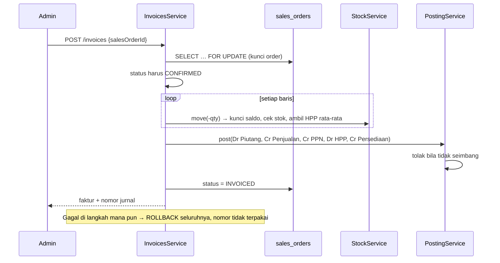

# Arsitektur SANSU

SANSU adalah **modular monolith multi-tenant**: satu proses API, satu database, tetapi batas modulnya setegas microservice sehingga bisa dipecah kelak tanpa menulis ulang.

## Gambaran sistem

```mermaid
flowchart TB
  subgraph Klien
    W[Web admin<br/>React + Ant Design]
    M[Aplikasi salesman<br/>React Native · roadmap]
  end
  subgraph Server
    N[Nginx<br/>file statis + proxy /api]
    A[API NestJS<br/>JWT · peran · validasi]
    subgraph Modul
      MD[Master data]
      INV[Inventori]
      S[Penjualan]
      ACC[Akuntansi]
      D[Dashboard]
    end
  end
  DB[(PostgreSQL 18.6)]
  SH[[@sansu/shared<br/>enum · label · tipe API]]

  W --> N --> A
  M -.-> A
  A --> MD & INV & S & D
  S --> INV
  S --> ACC
  INV --> ACC
  MD & INV & S & ACC & D --> DB
  SH -. dipakai .-> W
  SH -. dipakai .-> A
```

**Aturan dependensi antar-modul:** modul hanya memakai service yang diekspor modul lain. Penjualan memanggil `StockService` (inventori) dan `PostingService` (akuntansi); tidak ada modul yang menulis ke tabel milik modul lain secara langsung.

## Alur faktur (satu transaksi database)



## Jurnal otomatis

| Kejadian | Debit | Kredit |
| --- | --- | --- |
| Saldo awal stok | Persediaan | Ekuitas Saldo Awal |
| Stock opname kurang / rusak | Selisih Persediaan | Persediaan |
| Faktur penjualan | Piutang Usaha · HPP | Penjualan · PPN Keluaran · Persediaan |
| Pelunasan tunai / transfer | Kas / Bank | Piutang Usaha |

Akun sistem dicari lewat `system_key` (`AR`, `SALES`, `VAT_OUT`, ...), sehingga perusahaan bebas mengganti kode dan nama akunnya.

## Keamanan & multi-tenant

- JWT berisi `tenantId` dan `role`; guard global mewajibkan token kecuali endpoint `@Public()`.
- `@Roles('ADMIN','FINANCE')` per endpoint; `OWNER` selalu diizinkan.
- Setiap query bisnis memfilter `tenant_id` dari token — teruji di e2e (perusahaan lain mendapat 404).
- **Roadmap:** PostgreSQL Row-Level Security sebagai lapisan kedua (`SET LOCAL app.tenant_id` per transaksi).

## Menambah modul (contoh: Pembelian)

1. Tabel baru di berkas domainnya pada `backend/src/db/schema/` (mis. `inventory.ts`; ekspor lewat `schema/index.ts`) → `npm run db:generate` → `npm run db:migrate`.
2. Enum/status baru di `shared/src/domain.ts` (dengan label Indonesia), tipe respons di `contracts.ts`.
3. `backend/src/modules/purchasing/` — DTO, service, controller, module. Penerimaan barang:
   `StockService.move(tx, { type: 'PURCHASE', qty: +n, unitCost })` dan
   `PostingService.post(tx, …)` (Dr Persediaan, Dr PPN Masukan / Cr Hutang Usaha) dalam satu `db.transaction`.
4. Daftarkan di `app.module.ts`, tambahkan test e2e.
5. `frontend/src/features/purchasing/` + rute di `App.tsx` + menu di `AppLayout.tsx`.

## Roadmap teknis

- [ ] Pembelian & hutang usaha
- [ ] Retur penjualan, surat jalan terpisah
- [ ] Batch & kedaluwarsa (FEFO), transfer antar-gudang
- [ ] Ekspor e-Faktur / Coretax, cetak PDF & dot-matrix
- [ ] Aplikasi salesman offline-first (React Native, `mobile`)
- [ ] Row-Level Security PostgreSQL
- [ ] Antrian job (Redis + BullMQ) untuk impor Excel & laporan berat
- [ ] AG Grid untuk laporan ratusan ribu baris

## Isolasi perusahaan di dasar database (row-level security)

Selain filter `tenant_id` di kode, PostgreSQL sendiri menolak akses lintas perusahaan:

- Migrasi `0038_row_level_security.sql` membuat peran `sansu_app` (tanpa hak melewati RLS), mengaktifkan RLS pada **setiap tabel yang punya kolom `tenant_id`**, dan memasang kebijakan `tenant_isolation`
  (baris terlihat/tertulis hanya bila `tenant_id` = `app.tenant_id` sesi, atau sesi diberi `app.bypass_rls = on`).
- API memakai `TenantPool` (`backend/src/db/tenant-pool.ts`): setiap koneksi yang dipinjam berganti ke peran `sansu_app` dan diisi perusahaan dari lingkup permintaan (`TenantScopeInterceptor`, `db-scope.ts`).
  Lingkup dibaca saat `connect()` dipanggil (bukan saat antrean dilayani) agar tidak tertukar.
- Berjalan **tanpa penyaringan** (bypass) hanya untuk: permintaan tanpa pengguna (login, pendaftaran, tautan persetujuan, webhook), panel pemilik layanan (`PlatformAdminGuard`),
  tugas latar, serta migrasi/seed/cadangan (memakai pemilik tabel). Pengecualian dalam kode wajib lewat `withRlsBypass(tx, ...)` dan harus langka (contoh: nomor tagihan langganan global).
- Tabel baru yang punya `tenant_id` wajib ikut diamankan: tulis kebijakan yang sama di migrasinya. Tes `rls.e2e-spec.ts` gagal bila ada tabel ber-`tenant_id` tanpa RLS.
- Tabel anak tanpa `tenant_id` (mis. baris jurnal/faktur) tidak punya RLS sendiri; isolasinya mengikuti tabel induk (akses lewat ID induk yang sudah disaring).
- Saklar darurat: `RLS_DISABLED=true` di `.env` mengembalikan pool biasa (tanpa RLS). Gunakan hanya untuk diagnosis.
