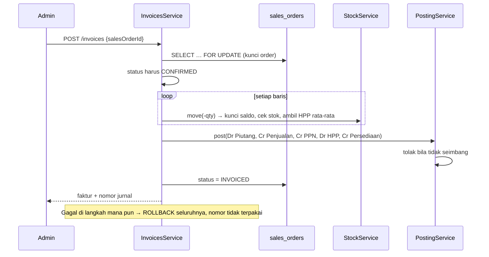

# Arsitektur SANSU

SANSU adalah **modular monolith multi-tenant**: satu proses API, satu database, tetapi batas modulnya setegas microservice sehingga bisa dipecah kelak tanpa menulis ulang.

## Gambaran sistem

```mermaid
flowchart TB
  subgraph Klien
    W[Web admin<br/>React + Ant Design]
    M[Aplikasi salesman<br/>React Native · roadmap]
  end
  subgraph Server
    N[Nginx<br/>file statis + proxy /api]
    A[API NestJS<br/>JWT · peran · validasi]
    subgraph Modul
      MD[Master data]
      INV[Inventori]
      S[Penjualan]
      ACC[Akuntansi]
      D[Dashboard]
    end
  end
  DB[(PostgreSQL 18.6)]
  SH[[@sansu/shared<br/>enum · label · tipe API]]

  W --> N --> A
  M -.-> A
  A --> MD & INV & S & D
  S --> INV
  S --> ACC
  INV --> ACC
  MD & INV & S & ACC & D --> DB
  SH -. dipakai .-> W
  SH -. dipakai .-> A
```

**Aturan dependensi antar-modul:** modul hanya memakai service yang diekspor modul lain. Penjualan memanggil `StockService` (inventori) dan `PostingService` (akuntansi); tidak ada modul yang menulis ke tabel milik modul lain secara langsung.

## Alur faktur (satu transaksi database)



## Jurnal otomatis

| Kejadian | Debit | Kredit |
| --- | --- | --- |
| Saldo awal stok | Persediaan | Ekuitas Saldo Awal |
| Stock opname kurang / rusak | Selisih Persediaan | Persediaan |
| Faktur penjualan | Piutang Usaha · HPP | Penjualan · PPN Keluaran · Persediaan |
| Pelunasan tunai / transfer | Kas / Bank | Piutang Usaha |

Akun sistem dicari lewat `system_key` (`AR`, `SALES`, `VAT_OUT`, ...), sehingga perusahaan bebas mengganti kode dan nama akunnya.

## Keamanan & multi-tenant

- JWT berisi `tenantId` dan `role`; guard global mewajibkan token kecuali endpoint `@Public()`.
- `@Roles('ADMIN','FINANCE')` per endpoint; `OWNER` selalu diizinkan.
- Setiap query bisnis memfilter `tenant_id` dari token — teruji di e2e (perusahaan lain mendapat 404).
- Lapisan kedua: PostgreSQL Row-Level Security (lihat "Isolasi perusahaan di dasar database").

## Menambah modul (contoh: Pembelian)

1. Tabel baru di berkas domainnya pada `backend/src/db/schema/` (mis. `inventory.ts`; ekspor lewat `schema/index.ts`) → `npm run db:generate` → `npm run db:migrate`.
2. Enum/status baru di `shared/src/domain.ts` (dengan label Indonesia), tipe respons di `contracts.ts`.
3. `backend/src/modules/purchasing/` — satu berkas per peran (`*.dto.ts`, `*.service.ts`, `*.controller.ts`, `*.module.ts`; lihat "Struktur kode"). Penerimaan barang:
   `StockService.move(tx, { type: 'PURCHASE', qty: +n, unitCost })` dan
   `PostingService.post(tx, …)` (Dr Persediaan, Dr PPN Masukan / Cr Hutang Usaha) dalam satu `db.transaction`.
4. Daftarkan di `app.module.ts`, tambahkan test e2e.
5. `frontend/src/features/purchasing/` + rute di `App.tsx` + menu di `AppLayout.tsx`.

## Roadmap teknis

- [ ] Pembelian & hutang usaha
- [ ] Retur penjualan, surat jalan terpisah
- [ ] Batch & kedaluwarsa (FEFO), transfer antar-gudang
- [ ] Ekspor e-Faktur / Coretax, cetak PDF & dot-matrix
- [ ] Aplikasi salesman offline-first (React Native, `mobile`)
- [x] Row-Level Security PostgreSQL (lihat bagian di bawah)
- [ ] Antrian job (Redis + BullMQ) untuk impor Excel & laporan berat
- [ ] AG Grid untuk laporan ratusan ribu baris

## Isolasi perusahaan di dasar database (row-level security)

Selain filter `tenant_id` di kode, PostgreSQL sendiri menolak akses lintas perusahaan:

- Migrasi `0038_row_level_security.sql` membuat peran `sansu_app` (tanpa hak melewati RLS), mengaktifkan RLS pada **setiap tabel yang punya kolom `tenant_id`**, dan memasang kebijakan `tenant_isolation`
  (baris terlihat/tertulis hanya bila `tenant_id` = `app.tenant_id` sesi, atau sesi diberi `app.bypass_rls = on`).
- API memakai `TenantPool` (`backend/src/db/tenant-pool.ts`): setiap koneksi yang dipinjam berganti ke peran `sansu_app` dan diisi perusahaan dari lingkup permintaan (`TenantScopeInterceptor`, `db-scope.ts`).
  Lingkup dibaca saat `connect()` dipanggil (bukan saat antrean dilayani) agar tidak tertukar.
- Berjalan **tanpa penyaringan** (bypass) hanya untuk: permintaan tanpa pengguna (login, pendaftaran, tautan persetujuan, webhook), panel pemilik layanan (`PlatformAdminGuard`),
  tugas latar, serta migrasi/seed/cadangan (memakai pemilik tabel). Pengecualian dalam kode wajib lewat `withRlsBypass(tx, ...)` dan harus langka (contoh: nomor tagihan langganan global).
- Tabel baru yang punya `tenant_id` wajib ikut diamankan: tulis kebijakan yang sama di migrasinya. Tes `rls.e2e-spec.ts` gagal bila ada tabel ber-`tenant_id` tanpa RLS.
- Tabel anak tanpa `tenant_id` (mis. baris jurnal/faktur) tidak punya RLS sendiri; isolasinya mengikuti tabel induk (akses lewat ID induk yang sudah disaring).
- Saklar darurat: `RLS_DISABLED=true` di `.env` mengembalikan pool biasa (tanpa RLS). Gunakan hanya untuk diagnosis.

## Struktur kode dan konvensi

**Satu berkas, satu peran.** Dalam `backend/src/modules/<modul>/`:

| Berkas | Isi |
| --- | --- |
| `NAMA.dto.ts` | kelas DTO (validasi `class-validator`, dokumentasi Swagger) |
| `NAMA.service.ts` | logika bisnis (`@Injectable`), satu-satunya lapisan yang berbicara ke database |
| `NAMA.controller.ts` | rute HTTP, peran (`@Roles`), validasi masuk; hanya memanggil service |
| `NAMA.module.ts` | hanya `@Module` (daftar controller, provider, impor, ekspor) |
| `NAMA.shared.ts` | konstanta/pembantu yang dipakai lebih dari satu peran di atas |

Skema database dipecah per domain di `backend/src/db/schema/` (`tenancy.ts`, `inventory.ts`, `sales.ts`, `accounting.ts`, ...); `schema/index.ts` mengekspor ulang semuanya, jadi impor tetap `from '../db/schema'`. Pembantu kolom (`id`, `money`, `qty`, `tenantId`) tidak boleh membuat siklus impor antar berkas skema.

Halaman React besar dipecah per komponen ke folder sebelah halamannya (mis. `features/platform/platform-admin/OverviewTab.tsx`); pembantu bersama di `shared.ts(x)` folder itu.

**Aturan yang dijaga uji otomatis** (`backend/src/architecture.spec.ts`, jalan di `npm test`):
1. berkas `*.dto/service/controller/module.ts` hanya berisi perannya;
2. controller tidak mengimpor ORM, skema, atau koneksi database;
3. service tidak mengimpor controller; DTO tidak mengimpor service/controller modul;
4. tidak ada siklus antar-modul (`src/modules/*`);
5. tidak ada berkas sumber di atas 700 baris (kecuali pembuat data demo). Service besar dipisah menurut tanggung jawab: bagian baca/laporan ke service tersendiri (`AssetReportsService`, `PurchaseReportsService`, `WarehouseQueryService`, `FinancialReportsService`).

Akses data: kueri sederhana (cari satu baris per id dan perusahaan) dipusatkan di repositori (`AssetRepository`, `PurchaseInvoiceRepository`, `AccountingRepository`, `WarehouseRepository`, `DeliveryTripRepository` (service rute pengiriman tidak lagi menulis kueri sendiri), `BankRepository`, `PosTabRepository`, serta `ReferenceRepository` bersama untuk gudang, pelanggan, akun, karyawan). Metodenya selalu menerima `db` (koneksi atau transaksi pemanggil) agar tetap satu transaksi. Semua kueri database berada di `*.repository.ts` (kelas `@Injectable` atau, untuk berkas helper tanpa kelas, fungsi biasa). Kueri lain dipindah ke repositori per service (`NAMA.repository.ts`, dibuat dengan alat berbasis tipe: setiap kueri dipindah utuh menjadi metode bernama dan memakai koneksi/transaksi pemanggil). Transaksi tetap dibuka di service. Pencarian satu baris milik perusahaan menurut id (dengan atau tanpa kunci `FOR UPDATE`) memakai pembantu generik `findOwned` / `lockOwned`, perubahan satu baris menurut id memakai `patchById`, dan sisipan satu baris memakai `insertOne` (semuanya di `db/owned.ts`) sehingga filter perusahaan selalu sama. Pelonggaran tipe `as never` dibatasi oleh uji arsitektur ke daftar tempat yang diizinkan; isi permintaan persetujuan dibaca lewat `payloadOf<T>()` yang menolak isi kosong.

**Aturan ketahanan:**
- Di dalam `db.transaction(async (tx) => ...)` jangan memakai `this.db` atau service yang memakai koneksinya sendiri: itu meminta koneksi kedua dari kolam dan bisa membuat server macet saat beban serentak. Teruskan `tx` (pembantu menerima `db: DbOrTx = this.db`). `TenantPool` menggagalkan tes bila ini terjadi; di produksi dicatat sebagai peringatan.
- Nomor/kode berurutan yang dibuat dari hitungan baris diserialkan per perusahaan (`pg_advisory_xact_lock`); pemeriksaan saldo kas diserialkan per akun kas.
- Permintaan yang mengubah data boleh membawa header `Idempotency-Key`; kirim ulang dengan kunci sama memutar ulang jawaban pertama (`common/idempotency`).
- Pemberitahuan latar belakang (`notifyRoles`) berjalan di luar lingkup transaksi pemanggil.

Aturan yang dijaga `backend/src/architecture.spec.ts` (8 aturan): satu berkas satu peran; controller tanpa ORM; arah dependensi ke bawah; tanpa siklus antar-modul; berkas maksimal 700 baris (kecuali pembuat data demo); `as never` hanya di `db/owned.ts`, `bootstrap.ts`, dan `modules/imports/imports.repository.ts`; kueri database hanya di repositori; repositori tidak mengimpor service atau controller. Pengecualian kueri langsung hanya untuk infrastruktur: `db/`, pembuat data demo, `modules/data-rights/`, `common/monitor/`, interceptor, dan guard. Pembantu `asDto` sudah dihapus: tipe masukan service dibuat sesuai bentuk sebenarnya, sehingga kode demo dan tes memanggil service tanpa pelonggaran tipe.

## Rincian & perhitungan akun (`modules/account-schedules`)
Menu khusus yang menampilkan, untuk setiap akun di laporan keuangan (neraca dan laba rugi), rincian, perhitungan, dan metodenya, lalu mencocokkan saldo akhirnya dengan angka akun itu **di laporan keuangan** (dibaca dari `StatementsService`, bukan dari buku besar).
- **Kontrak**: antarmuka `AccountSchedule` (`supports(akun)`, `build(konteks)`). Tiap jenis akun satu kelas (`schedules/`): aset tetap (perolehan, akumulasi, beban penyusutan), piutang dan utang per pihak, persediaan per produk, kas/bank, pajak, ekuitas, laba belum ditutup, pendapatan, HPP, beban, dan `GenericSchedule`.
- **Tabel bertipe**: setiap jadwal mendefinisikan kolom dan barisnya sendiri (`ScheduleTable`); halaman hanya menggambarnya, tanpa kondisi per akun. Mutasi per bulan (saldo awal, penambahan, pengurangan, saldo akhir; akun laba rugi: jumlah bulan dan akumulasi) selalu ada sebagai pembanding buku besar.
- **Akun baru otomatis**: `ScheduleRegistry` memilih jadwal pertama yang `supports` akun; `GenericSchedule` menerima semua akun sehingga akun baru langsung punya mutasi bulanan dan ditandai "metode perlu ditentukan". Menambah jenis jadwal baru = satu kelas baru + satu baris di registri.
- **Selisih tidak disembunyikan**: bila rincian (daftar aset, faktur, kartu stok) berbeda dari buku besar, selisihnya tampil sebagai baris "penyesuaian lain" atau temuan, dan status akun menjadi "tidak cocok" bila saldo rincian berbeda dari laporan.
- Menu Aset tetap lama dilebur ke halaman ini (tab "Kelola aset tetap"); `/fixed-assets` dialihkan.
- Tes: `test/rincian-akun.e2e-spec.ts` (semua jenis usaha, rantai saldo bulanan, akun baru, aset dengan penyusutan dan pelepasan).
- **Rekonsiliasi bank** (`BankReconciliationSchedule`): memakai `BankService.reconciliation` yang sama dengan menu Bank (saldo koran ± setoran dalam perjalanan dan pembayaran belum cair = saldo buku ± mutasi bank belum dibukukan) beserta pengesahan bulanan. Akun bank = akun bank bawaan atau yang sudah mengimpor rekening koran.
- **Akun tanpa daftar sendiri** (`JournalItemSchedule`, template method): rincian dari jurnal akun itu (saldo awal, penambahan, pengurangan per jurnal, tautan ke jurnal). Subkelas menambah perhitungan khasnya: `PrepaidSchedule` (sisa jadwal amortisasi dari jurnal berulang aktif dibandingkan dengan saldo), `AccrualSchedule` (jurnal balik terjadwal yang menunggu), `DeferredRevenueSchedule`, `LoanSchedule` (pencairan, angsuran, bunga bulanan dan tarif efektif perkiraan dari beban keuangan). Rincian per item berasal dari jurnal; bila kontraknya terdaftar di data induk (di bawah), jadwal kontraktualnya ikut ditampilkan dan dibandingkan.
- **Pembekuan laporan** (`report_snapshots`, migrasi 0106): angka tiap akun dan total laporan disimpan per tahun per versi dengan hash isi; trigger database melarang ubah/hapus (pengecualian hanya jalur penghapusan data perusahaan). `GET /account-schedules/snapshots/compare` membandingkan dengan pembukuan terkini: selisih per akun dan jurnal yang dibukukan sesudah pembekuan. Hanya Pemilik/Admin/Akuntan yang membekukan.
- **Data induk kontrak** (`financing_contracts`, migrasi 0107; `/financing-contracts`): pinjaman, sewa pembiayaan (liabilitas sewa, PSAK 73/SAK EP), dan biaya dibayar di muka. `contract-calc.ts` (fungsi murni, dites di `contract-calc.spec.ts`) menghitung jadwal per bulan (anuitas, pokok tetap, bullet, garis lurus; selisih pembulatan di bulan terakhir). `ContractExtras` membandingkan jadwal kontraktual dengan buku besar per akun: penambahan, pokok/amortisasi, bunga, saldo akhir; selisih jadi temuan. Akun dengan kontrak terdaftar selalu tampil dan memakai jadwal sesuai jenis kontrak (`LeaseSchedule` hanya lewat kontrak). Pendaftaran kontrak tidak membuat jurnal.
- **Snapshot memuat seluruh rincian**: `payload.schedules` menyimpan hasil lengkap tiap akun (tabel, metode, temuan) dan `detailHash` per akun; `GET /account-schedules/snapshots/detail` membuka rincian sebagaimana ditandatangani, dan perbandingan menandai akun yang rinciannya berubah walau saldonya sama. Pembekuan versi lama (tanpa rincian) tetap dapat dibandingkan, tetapi rinciannya tidak tersedia.

