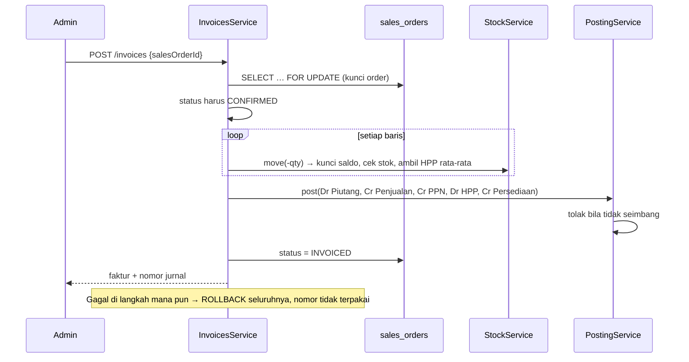

# Arsitektur SANSU

SANSU adalah **modular monolith multi-tenant**: satu proses API, satu database, tetapi batas modulnya setegas microservice sehingga bisa dipecah kelak tanpa menulis ulang.

## Gambaran sistem

```mermaid
flowchart TB
  subgraph Klien
    W[Web admin<br/>React + Ant Design]
    M[Aplikasi salesman<br/>React Native · roadmap]
  end
  subgraph Server
    N[Nginx<br/>file statis + proxy /api]
    A[API NestJS<br/>JWT · peran · validasi]
    subgraph Modul
      MD[Master data]
      INV[Inventori]
      S[Penjualan]
      ACC[Akuntansi]
      D[Dashboard]
    end
  end
  DB[(PostgreSQL 18.6)]
  SH[[@sansu/shared<br/>enum · label · tipe API]]

  W --> N --> A
  M -.-> A
  A --> MD & INV & S & D
  S --> INV
  S --> ACC
  INV --> ACC
  MD & INV & S & ACC & D --> DB
  SH -. dipakai .-> W
  SH -. dipakai .-> A
```

**Aturan dependensi antar-modul:** modul hanya memakai service yang diekspor modul lain. Penjualan memanggil `StockService` (inventori) dan `PostingService` (akuntansi); tidak ada modul yang menulis ke tabel milik modul lain secara langsung.

## Alur faktur (satu transaksi database)



## Jurnal otomatis

| Kejadian | Debit | Kredit |
| --- | --- | --- |
| Saldo awal stok | Persediaan | Ekuitas Saldo Awal |
| Stock opname kurang / rusak | Selisih Persediaan | Persediaan |
| Faktur penjualan | Piutang Usaha · HPP | Penjualan · PPN Keluaran · Persediaan |
| Pelunasan tunai / transfer | Kas / Bank | Piutang Usaha |

Akun sistem dicari lewat `system_key` (`AR`, `SALES`, `VAT_OUT`, ...), sehingga perusahaan bebas mengganti kode dan nama akunnya.

## Keamanan & multi-tenant

- JWT berisi `tenantId` dan `role`; guard global mewajibkan token kecuali endpoint `@Public()`.
- `@Roles('ADMIN','FINANCE')` per endpoint; `OWNER` selalu diizinkan.
- Setiap query bisnis memfilter `tenant_id` dari token — teruji di e2e (perusahaan lain mendapat 404).
- Lapisan kedua: PostgreSQL Row-Level Security (lihat "Isolasi perusahaan di dasar database").

## Menambah modul (contoh: Pembelian)

1. Tabel baru di berkas domainnya pada `backend/src/db/schema/` (mis. `inventory.ts`; ekspor lewat `schema/index.ts`) → `npm run db:generate` → `npm run db:migrate`.
2. Enum/status baru di `shared/src/domain.ts` (dengan label Indonesia), tipe respons di `contracts.ts`.
3. `backend/src/modules/purchasing/` — satu berkas per peran (`*.dto.ts`, `*.service.ts`, `*.controller.ts`, `*.module.ts`; lihat "Struktur kode"). Penerimaan barang:
   `StockService.move(tx, { type: 'PURCHASE', qty: +n, unitCost })` dan
   `PostingService.post(tx, …)` (Dr Persediaan, Dr PPN Masukan / Cr Hutang Usaha) dalam satu `db.transaction`.
4. Daftarkan di `app.module.ts`, tambahkan test e2e.
5. `frontend/src/features/purchasing/` + rute di `App.tsx` + menu di `AppLayout.tsx`.

## Roadmap teknis

- [ ] Pembelian & hutang usaha
- [ ] Retur penjualan, surat jalan terpisah
- [ ] Batch & kedaluwarsa (FEFO), transfer antar-gudang
- [ ] Ekspor e-Faktur / Coretax, cetak PDF & dot-matrix
- [ ] Aplikasi salesman offline-first (React Native, `mobile`)
- [x] Row-Level Security PostgreSQL (lihat bagian di bawah)
- [ ] Antrian job (Redis + BullMQ) untuk impor Excel & laporan berat
- [ ] AG Grid untuk laporan ratusan ribu baris

## Isolasi perusahaan di dasar database (row-level security)

Selain filter `tenant_id` di kode, PostgreSQL sendiri menolak akses lintas perusahaan:

- Migrasi `0038_row_level_security.sql` membuat peran `sansu_app` (tanpa hak melewati RLS), mengaktifkan RLS pada **setiap tabel yang punya kolom `tenant_id`**, dan memasang kebijakan `tenant_isolation`
  (baris terlihat/tertulis hanya bila `tenant_id` = `app.tenant_id` sesi, atau sesi diberi `app.bypass_rls = on`).
- API memakai `TenantPool` (`backend/src/db/tenant-pool.ts`): setiap koneksi yang dipinjam berganti ke peran `sansu_app` dan diisi perusahaan dari lingkup permintaan (`TenantScopeInterceptor`, `db-scope.ts`).
  Lingkup dibaca saat `connect()` dipanggil (bukan saat antrean dilayani) agar tidak tertukar.
- Berjalan **tanpa penyaringan** (bypass) hanya untuk: permintaan tanpa pengguna (login, pendaftaran, tautan persetujuan, webhook), panel pemilik layanan (`PlatformAdminGuard`),
  tugas latar, serta migrasi/seed/cadangan (memakai pemilik tabel). Pengecualian dalam kode wajib lewat `withRlsBypass(tx, ...)` dan harus langka (contoh: nomor tagihan langganan global).
- Tabel baru yang punya `tenant_id` wajib ikut diamankan: tulis kebijakan yang sama di migrasinya. Tes `rls.e2e-spec.ts` gagal bila ada tabel ber-`tenant_id` tanpa RLS.
- Tabel anak tanpa `tenant_id` (mis. baris jurnal/faktur) tidak punya RLS sendiri; isolasinya mengikuti tabel induk (akses lewat ID induk yang sudah disaring).
- Saklar darurat: `RLS_DISABLED=true` di `.env` mengembalikan pool biasa (tanpa RLS). Gunakan hanya untuk diagnosis.

## Struktur kode dan konvensi

**Satu berkas, satu peran.** Dalam `backend/src/modules/<modul>/`:

| Berkas | Isi |
| --- | --- |
| `NAMA.dto.ts` | kelas DTO (validasi `class-validator`, dokumentasi Swagger) |
| `NAMA.service.ts` | logika bisnis (`@Injectable`), satu-satunya lapisan yang berbicara ke database |
| `NAMA.controller.ts` | rute HTTP, peran (`@Roles`), validasi masuk; hanya memanggil service |
| `NAMA.module.ts` | hanya `@Module` (daftar controller, provider, impor, ekspor) |
| `NAMA.shared.ts` | konstanta/pembantu yang dipakai lebih dari satu peran di atas |

Skema database dipecah per domain di `backend/src/db/schema/` (`tenancy.ts`, `inventory.ts`, `sales.ts`, `accounting.ts`, ...); `schema/index.ts` mengekspor ulang semuanya, jadi impor tetap `from '../db/schema'`. Pembantu kolom (`id`, `money`, `qty`, `tenantId`) tidak boleh membuat siklus impor antar berkas skema.

Halaman React besar dipecah per komponen ke folder sebelah halamannya (mis. `features/platform/platform-admin/OverviewTab.tsx`); pembantu bersama di `shared.ts(x)` folder itu.

**Aturan yang dijaga uji otomatis** (`backend/src/architecture.spec.ts`, jalan di `npm test`):
1. berkas `*.dto/service/controller/module.ts` hanya berisi perannya;
2. controller tidak mengimpor ORM, skema, atau koneksi database;
3. service tidak mengimpor controller; DTO tidak mengimpor service/controller modul;
4. tidak ada siklus antar-modul (`src/modules/*`);
5. tidak ada berkas sumber di atas 700 baris (kecuali pembuat data demo). Service besar dipisah menurut tanggung jawab: bagian baca/laporan ke service tersendiri (`AssetReportsService`, `PurchaseReportsService`, `WarehouseQueryService`, `FinancialReportsService`).

Akses data: kueri sederhana (cari satu baris per id dan perusahaan) dipusatkan di repositori (`AssetRepository`, `PurchaseInvoiceRepository`, `AccountingRepository`, `WarehouseRepository`, `DeliveryTripRepository` (service rute pengiriman tidak lagi menulis kueri sendiri), `BankRepository`, `PosTabRepository`, serta `ReferenceRepository` bersama untuk gudang, pelanggan, akun, karyawan). Metodenya selalu menerima `db` (koneksi atau transaksi pemanggil) agar tetap satu transaksi. Semua kueri database berada di `*.repository.ts` (kelas `@Injectable` atau, untuk berkas helper tanpa kelas, fungsi biasa). Kueri lain dipindah ke repositori per service (`NAMA.repository.ts`, dibuat dengan alat berbasis tipe: setiap kueri dipindah utuh menjadi metode bernama dan memakai koneksi/transaksi pemanggil). Transaksi tetap dibuka di service. Pencarian satu baris milik perusahaan menurut id (dengan atau tanpa kunci `FOR UPDATE`) memakai pembantu generik `findOwned` / `lockOwned`, perubahan satu baris menurut id memakai `patchById`, dan sisipan satu baris memakai `insertOne` (semuanya di `db/owned.ts`) sehingga filter perusahaan selalu sama. Pelonggaran tipe `as never` dibatasi oleh uji arsitektur ke daftar tempat yang diizinkan; isi permintaan persetujuan dibaca lewat `payloadOf<T>()` yang menolak isi kosong.

**Aturan ketahanan:**
- Di dalam `db.transaction(async (tx) => ...)` jangan memakai `this.db` atau service yang memakai koneksinya sendiri: itu meminta koneksi kedua dari kolam dan bisa membuat server macet saat beban serentak. Teruskan `tx` (pembantu menerima `db: DbOrTx = this.db`). `TenantPool` menggagalkan tes bila ini terjadi; di produksi dicatat sebagai peringatan.
- Nomor/kode berurutan yang dibuat dari hitungan baris diserialkan per perusahaan (`pg_advisory_xact_lock`); pemeriksaan saldo kas diserialkan per akun kas.
- Permintaan yang mengubah data boleh membawa header `Idempotency-Key`; kirim ulang dengan kunci sama memutar ulang jawaban pertama (`common/idempotency`).
- Pemberitahuan latar belakang (`notifyRoles`) berjalan di luar lingkup transaksi pemanggil.

Aturan yang dijaga `backend/src/architecture.spec.ts` (8 aturan): satu berkas satu peran; controller tanpa ORM; arah dependensi ke bawah; tanpa siklus antar-modul; berkas maksimal 700 baris (kecuali pembuat data demo); `as never` hanya di `db/owned.ts`, `bootstrap.ts`, dan `modules/imports/imports.repository.ts`; kueri database hanya di repositori; repositori tidak mengimpor service atau controller. Pengecualian kueri langsung hanya untuk infrastruktur: `db/`, pembuat data demo, `modules/data-rights/`, `common/monitor/`, interceptor, dan guard. Pembantu `asDto` sudah dihapus: tipe masukan service dibuat sesuai bentuk sebenarnya, sehingga kode demo dan tes memanggil service tanpa pelonggaran tipe.

## Laporan pendukung per akun (`modules/account-schedules`)
Di halaman Laporan pendukung, setiap akun yang tampil di laporan keuangan punya **satu tab sendiri** (neraca dahulu, lalu laba rugi), disesuaikan dengan bagan akun jenis usaha perusahaan. Tab berisi rincian, daftar, dan perhitungan khusus akun itu, dan saldo akhirnya dicocokkan dengan angka akun itu **di laporan keuangan** (`StatementsService`), bukan dengan buku besar.
- **Daftar tab**: `GET /account-schedules/tabs` = akun aktif di bagan akun perusahaan (akun yang tidak relevan untuk jenis usaha dinonaktifkan otomatis) ditambah akun yang kebetulan punya saldo/mutasi, plus laba berjalan yang belum ditutup. Akun baru otomatis punya tab. Isi tab dibangun saat dibuka (`GET /account-schedules/:accountId`).
- **Kontrak**: antarmuka `AccountSchedule` (`supports`, `build`); `ScheduleRegistry` memilih jadwal pertama (urutan dari yang paling khusus) yang `supports` akun itu; `GenericSchedule` terakhir sebagai cadangan (akun ditandai "metode perlu ditentukan").
- **Jadwal khusus**: kas, bank (rekonsiliasi), piutang/utang per pihak, persediaan (kartu stok), aset tetap (mutasi, akumulasi, penyusutan per aset dan bulan), pajak, dibayar di muka, akrual, pendapatan diterima di muka, pinjaman, ekuitas, laba berjalan; dan jadwal berbasis jurnal dengan umur saldo FIFO dan kartu pembantu akun: piutang lain/aset lain (`OtherAssetSchedule`: platform pesan-antar, QRIS/kartu, klaim prinsipal, antar cabang, aset kontrak, kasbon, retensi, jaminan), utang lain (`OtherLiabilitySchedule`: poin loyalitas, retensi), penyesuaian kurs valas dengan posisi per mata uang, pajak lain, pajak tangguhan, imbalan kerja, persediaan lain (dalam perjalanan, proses, setengah jadi), cadangan kerugian piutang. Akun laba rugi memakai mutasi bulanan ditambah rincian menurut sumber transaksi dan transaksi terbesar.
- **Daftar dan rincian dari dokumen sumber** (`schedules/document-tables.ts`, ditambahkan `AccountSchedulesService.run` pada setiap tab kecuali kartu stok dan register aset): setiap baris jurnal akun ditelusuri ke dokumennya (faktur, pembayaran, retur, surat jalan, penerimaan barang, kas, kasir, gaji, aset, uang muka, setoran pajak, kemajuan proyek) lewat `documentLines`; ditampilkan sebagai daftar dokumen (saldo awal + mutasi = saldo di laporan keuangan), rekap per pihak dan per jenis dokumen, serta rekap per produk (penjualan, HPP) dan per karyawan (slip gaji). Piutang/utang memakai umur per faktur terbuka dan per pihak; persediaan per produk dan per gudang.
- **Selisih tidak disembunyikan**: bila rincian berbeda dari buku besar/laporan, tampil sebagai temuan dan status akun menjadi "selisih".
- Tes: `test/rincian-akun*.e2e-spec.ts` (tujuh jenis usaha: tiap tab terbuka, cocok dengan laporan, tidak ada akun tanpa jadwal khusus).
- Dihapus atas permintaan pemakai: pembekuan laporan (`report_snapshots`), kontrak pembiayaan (`financing_contracts`), dan laporan "Akun lainnya" (migrasi 0109).

